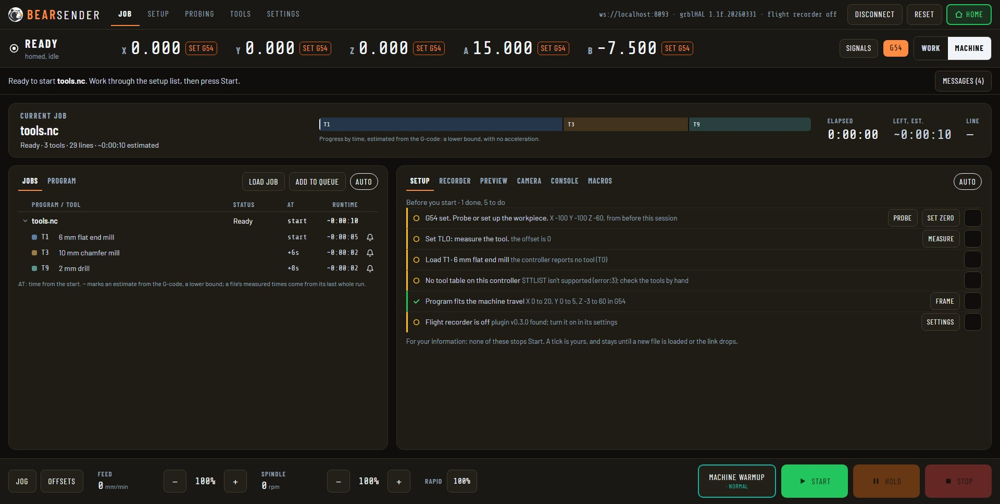

# BearSender

A G-code sender for grblHAL that runs in the browser, built as one self-contained HTML file. Nothing to install: open it and connect.
It was FlexiSender, and is based on the original flexisender from [Expatria](https://github.com/Expatria-Technologies). The repository keeps the old name.

[BearSender](https://bisonactual.github.io/Flexisender2/bearsender.html). The old addresses, `flexisender.html` and `Flexisender-Flightrecorder.html`, open it too.

## The screens
- **Job:**
  - the current job, with its progress by time;
  - the Jobs list (a queue, kept in the browser) and the Program;
  - a panel with tabs: the Setup checks before you start, the flight Recorder, the 3D Preview, the Camera, the Console and your Macros.
- **Setup:** position, jogging, spindle and coolant, overrides, the program's limits and framing, surfacing, the work offsets, and the spindle warmup routines.
- **Probing:** tool length, edge finder, centre finder and rotation, each drawn before it runs.
- **Tools:** the controller's tool table (`$TTLIST`), beside the tools the loaded program uses.
- **Settings:**
  - the controller's `$` settings, with their descriptions, read and written;
  - exclusion zones;
  - BearSender's options: connection, colours, jog steps and more;
  - the probe settings;
  - the flight recorder's settings.

**Kept on screen everywhere:**
- the position line, with every axis the controller has, and SET to zero one in the active offset;
- the message line, which says what the machine needs next;
- the bottom bar: jog and offsets, the overrides, MACHINE WARMUP, and START, HOLD and STOP.

**What BearSender tells you is information, not a gate.** Nothing blocks Start, Home or jogging: you are the operator. A button that does something does it on one tap. The one exception is MACHINE WARMUP, which you hold for 5 seconds.

## Connecting
- **WebSocket:** over your network, to `ws://host:port`. This is the default, and works in any modern browser.
- **USB / Serial:** with the Web Serial API, in Chrome or Edge. Pick it in Settings, Options; CONNECT then opens the browser's port picker.

The address and the serial settings are in Settings, Options. On connecting, BearSender reads the controller's build (`$I+`): its axes, its buffer size and its plugins, such as Flight Recorder, Exclusion Zones and the Sienci ATCi.

## Sending
- **Every line goes through one command layer.** It counts the bytes in the controller's buffer and matches each `ok` or `error` to the line that caused it.
- **On an error mid-job,** the job holds, and nothing is sent in between.
- **Stop** holds first, then resets once the machine has stopped.
- **The flight recorder plugin,** when you turn it on, stamps each job and numbers its lines. If the link drops, the controller lifts the tool and stops the spindle, and BearSender offers to resume from the line it got to.

## Requirements
- A grblHAL controller, with WebSocket for WebSocket mode or a USB connection for Serial mode.
- Any modern browser for WebSocket; Chrome or Edge for USB / Serial.

## Building
[Bun](https://bun.sh):
- `bun install`, then `bun run build`, writes `dist/bearsender.html` (and the redirect pages);
- `bun run dev` serves the source on port 3000 and reloads on every change.

See `runbook.md`. The Pages workflow (`.github/workflows/pages.yml`) builds and publishes `dist/` on every push to `main`.

## License
GPL
